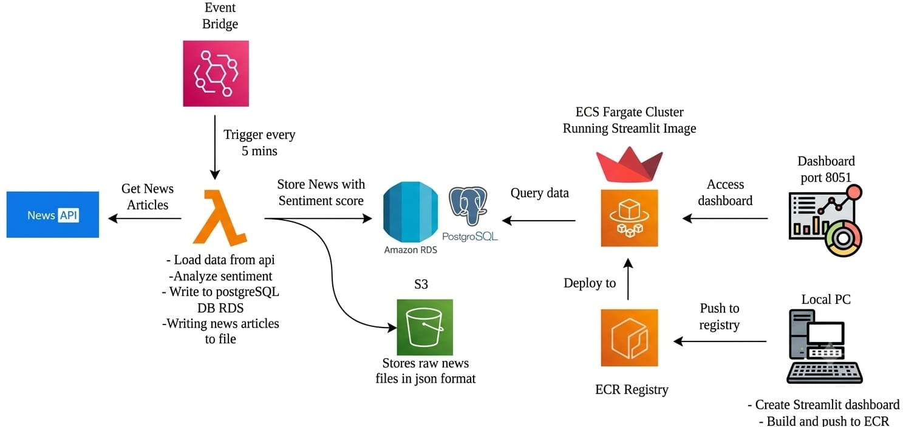
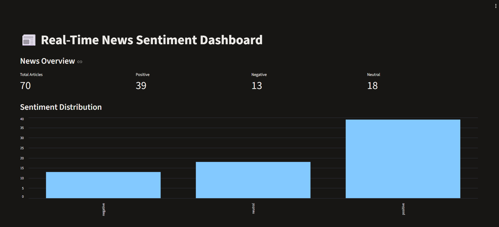
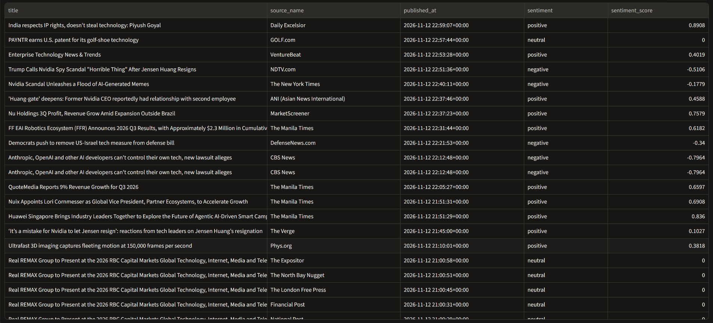

# Real-Time News Sentiment Analysis on AWS


## System Architecture



## Dashboard Preview

### Dashboard – Overview



### Dashboard – Sentiment Analysis



## 1. Project Overview

Real-Time News Sentiment Analysis is an end-to-end cloud-based data engineering and sentiment analysis project. It automatically collects technology-related news articles, analyzes their sentiment using VADER, stores raw and processed data, and displays the results through an interactive Streamlit dashboard.

The pipeline uses AWS services and Docker containers to automate data collection, processing, storage, and visualization.

## 2. Architecture

**Workflow:**

1. Amazon EventBridge Scheduler triggers the Lambda function every 5 minutes.
2. AWS Lambda fetches technology news from the GNews API.
3. Python processes and cleans the collected articles.
4. VADER performs sentiment analysis and assigns Positive, Negative, or Neutral labels.
5. Raw news JSON data is stored in Amazon S3.
6. Processed articles and sentiment scores are stored in Amazon RDS PostgreSQL.
7. Amazon ECS with AWS Fargate hosts the Streamlit dashboard.
8. The dashboard retrieves data from PostgreSQL and displays article statistics, sentiment distribution, and news records.

## 3. Technologies Used

- **Programming:** Python
- **Data Processing:** Pandas, NumPy
- **Sentiment Analysis:** VADER
- **API:** GNews API
- **Database:** PostgreSQL, Amazon RDS
- **Cloud:** AWS Lambda, Amazon S3, Amazon ECS, AWS Fargate, Amazon ECR, Amazon EventBridge, IAM, CloudWatch
- **Containerization:** Docker
- **Dashboard:** Streamlit
- **Version Control:** Git and GitHub

## 4. Project Structure

```text
news-sentiment-analysis/
│
├── dashboard/
│   ├── app.py
│   └── Dockerfile
│
├── src/
│   ├── database/
│   │   ├── connection.py
│   │   ├── insert_news.py
│   │   ├── tables.py
│   │   ├── test_connection.py
│   │   └── test_insert.py
│   │
│   ├── news/
│   │   ├── gnews.py
│   │   ├── processor.py
│   │   ├── test_gnews.py
│   │   └── test_processor.py
│   │
│   ├── sentiment/
│   │   ├── analyzer.py
│   │   └── test_analyzer.py
│   │
│   ├── storage/
│   │   ├── s3.py
│   │   └── test_s3.py
│   │
│   └── lambda_function.py
│
├── Dockerfile
├── .dockerignore
├── .gitignore
├── requirements.txt
└── README.md
```

## 5. Local Setup

### Prerequisites

- Python 3.13
- Git
- Docker
- AWS account
- GNews API key

### Clone the repository

```bash
git clone https://github.com/swathimk2002/news-sentiment-analysis.git
cd news-sentiment-analysis
```

### Create a virtual environment

```bash
python -m venv venv
```

Activate it on Windows:

```powershell
venv\Scripts\activate
```

### Install dependencies

```bash
pip install -r requirements.txt
```

### Configure environment variables

Create a `.env` file in the project root with the required GNews API and database configuration.

Never commit `.env` or expose API keys and database passwords.

## 6. AWS Deployment

The application uses two Docker images:

- **Lambda image:** Executes the automated news collection and processing pipeline.
- **Dashboard image:** Runs the Streamlit application on port 8501.

The images are stored in Amazon ECR.

AWS Lambda runs the processing pipeline, while Amazon ECS with AWS Fargate hosts the dashboard. Amazon EventBridge Scheduler invokes Lambda every five minutes.

Amazon S3 stores raw news JSON files, and Amazon RDS PostgreSQL stores processed article records.

## 7. Sentiment Analysis

VADER assigns a compound sentiment score to each article.

- Positive: Compound score >= 0.05
- Negative: Compound score <= -0.05
- Neutral: Compound score between -0.05 and 0.05

The dashboard displays sentiment counts, distribution charts, and collected news articles.

## 8. Testing and Validation

The following components were tested:

- GNews API data collection
- Data cleaning and processing
- VADER sentiment analysis
- PostgreSQL database connection and insertion
- Amazon S3 JSON uploads
- Docker image builds and local dashboard execution
- AWS Lambda execution
- EventBridge scheduled invocation
- ECS Fargate dashboard deployment
- Dashboard connectivity to RDS PostgreSQL
- End-to-end article updates

The deployed dashboard was verified to display article data. During scheduled pipeline validation, the article count increased from 35 to 36, confirming that newly collected articles reached the dashboard.

## 9. Security Note

This deployment uses public connectivity for educational demonstration and testing. The database and dashboard security-group rules should be restricted before using the application in a production environment.

Keep API keys, passwords, and AWS credentials outside version control.

## 10. Repository

GitHub: https://github.com/swathimk2002/news-sentiment-analysis
